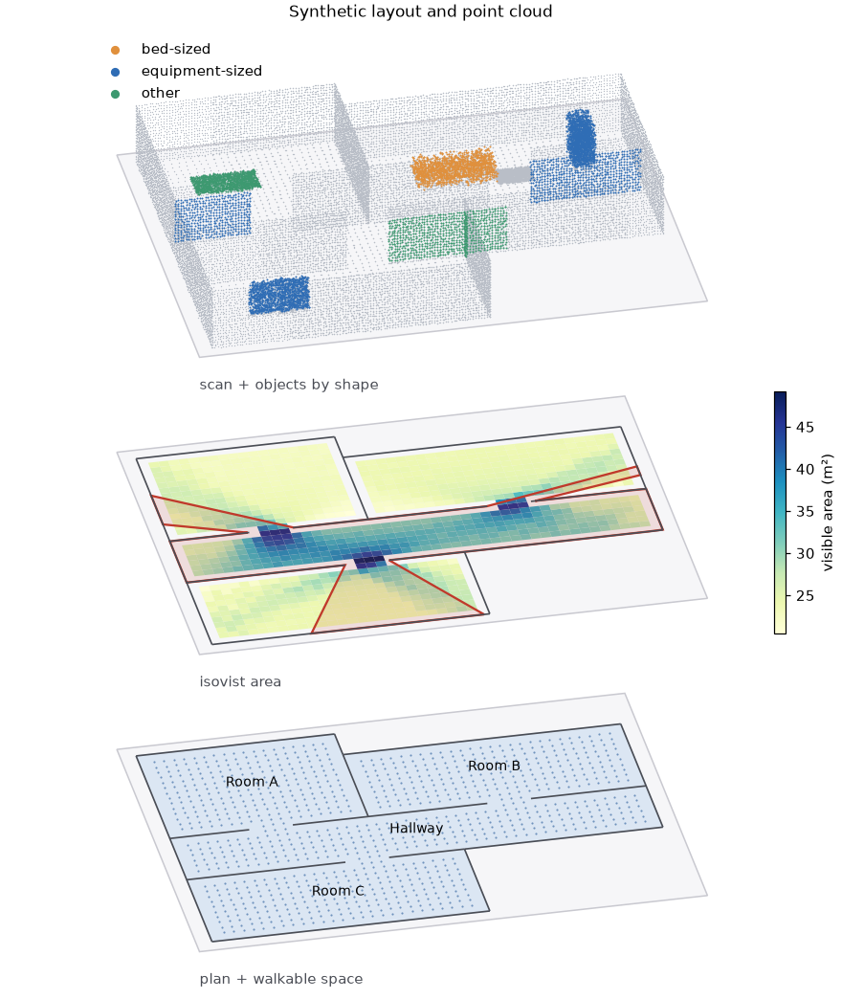

# spatial-twin

Turns a floor plan and point clouds into a spatial twin.

Author: Salome Egli

- **Registration:** scan to scan in 3-D (FPFH + RANSAC, then ICP), and scan to plan or to another scan's walls (FFT sweep over every pose, then ICP, scored on wall runs). Scale is fixed.
- **Isovists:** area, perimeter, compactness, occlusivity, radial statistics and drift.
- **Walkable space:** where a person can stand, clear of barriers.
- **Objects by shape:** long, straight, tall runs are removed as walls, and what remains 0.1–2.0 m above the local floor is clustered in 3-D and labelled person-sized, bed-sized, equipment-sized or other.
- **Twin figure:** plan, isovist field and scan in one projection.



## Install

Tested with Python 3.12.

```sh
python -m venv .venv && source .venv/bin/activate
pip install -r requirements.txt
```

## Quick example

```sh
python -m spatial_twin.demo
```

```python
from spatial_twin import cast, scan_to_plan, synthetic

scan = synthetic.cloud()
fit = scan_to_plan(scan, synthetic.WALLS)
print(fit.residual, fit.inliers, fit.passes(gate_mm=200))
print(cast(4500, 4000, synthetic.WALLS).properties()["area_m2"])
```

## Limits

Units are millimetres and the 2-D fits need levelled scans. **A good residual is not proof of a correct pose.** In our synthetic tests at 74% overlap, the wall-only fit was turned or shifted in every trial and still passed a 150 mm gate. Below about 90% overlap, or in symmetrical spaces, check each fit against a known landmark. A low `fitness` means the 3-D fit is not to be trusted. Shape labels are sizes, not object recognition, and are measured along the plan's axes, so a rotated object looks bigger. Short wall pieces can survive as objects, and tall objects in a straight run can be removed as wall. Leaving out person-sized objects is **not anonymisation**: people who are seated, lying, grouped or against a wall will remain.

## Part of the toolkit

Five tools for field studies with wearable sensors:

[field-logger](https://github.com/cambridge-cognitive-architecture/field-logger) → [wearable-pipeline](https://github.com/cambridge-cognitive-architecture/wearable-pipeline) → **spatial-twin** → field-workbench (in preparation) → [egoanon](https://github.com/cambridge-cognitive-architecture/egoanon)

<!-- Overview diagram goes here: docs/toolkit.png -->

| Tool | What it does |
|---|---|
| [field-logger](https://github.com/cambridge-cognitive-architecture/field-logger) | tablet app: location by threshold crossings, tasks, interruptions and ratings, on one clock |
| [wearable-pipeline](https://github.com/cambridge-cognitive-architecture/wearable-pipeline) | eye tracking, ECG and the field log on one clock; pupil and HRV preprocessing; quality control |
| **spatial-twin** (this repository) | LiDAR scans against the floor plan: registration, isovists, walkable space, objects |
| field-workbench (in preparation) | one local app from project set-up through coding and compute to the master table |
| [egoanon](https://github.com/cambridge-cognitive-architecture/egoanon) | anonymisation of the head-mounted scene video |

## Licence and credit

MIT, see [LICENSE](LICENSE). Developed by the Cambridge Cognitive Architecture Lab.
